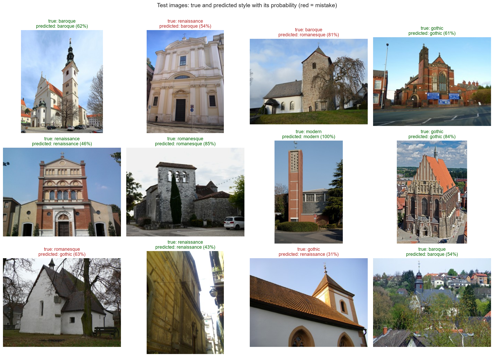
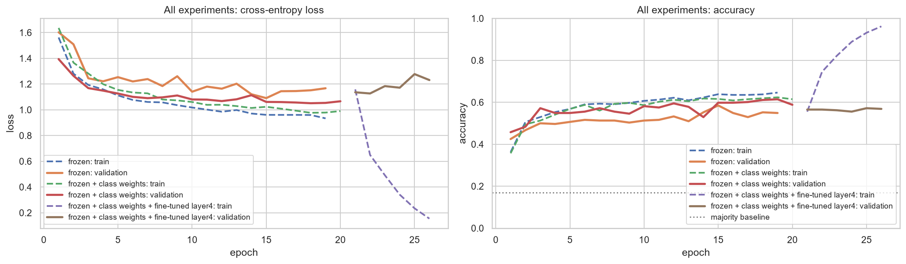
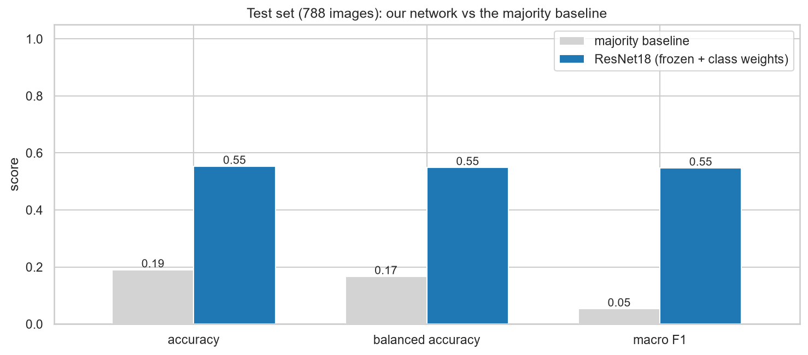
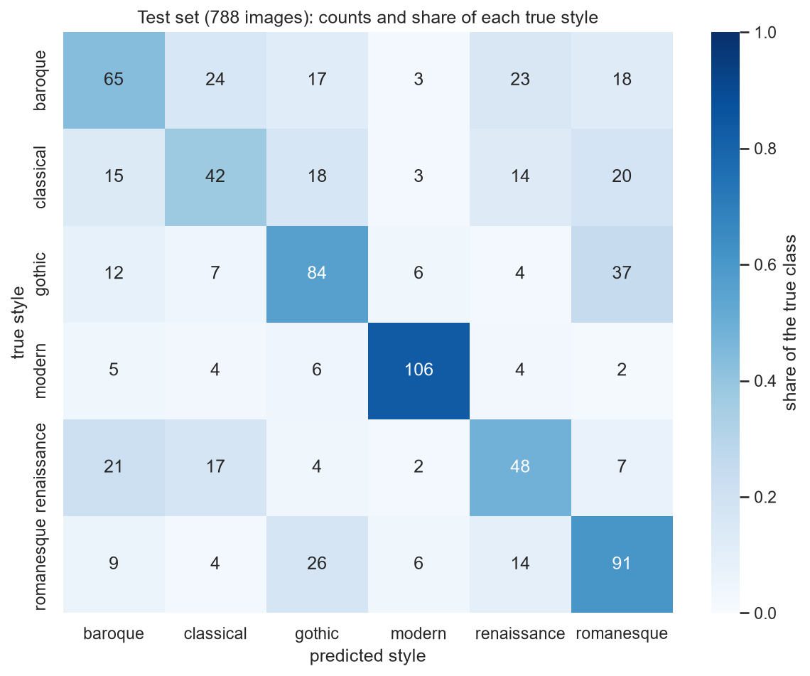
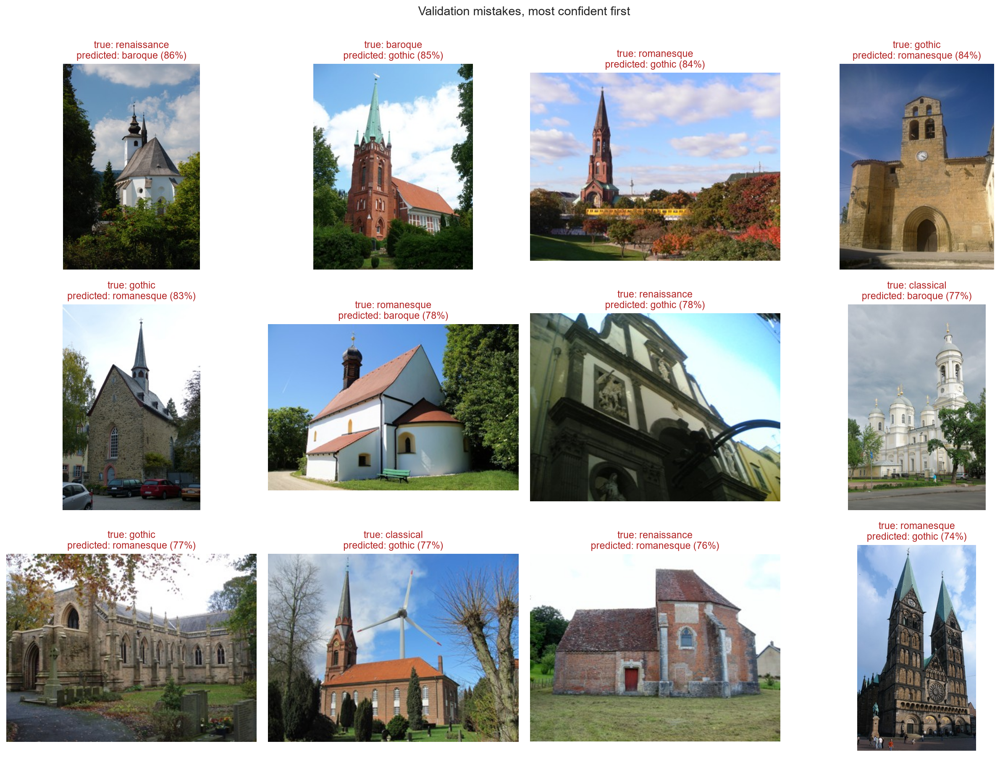
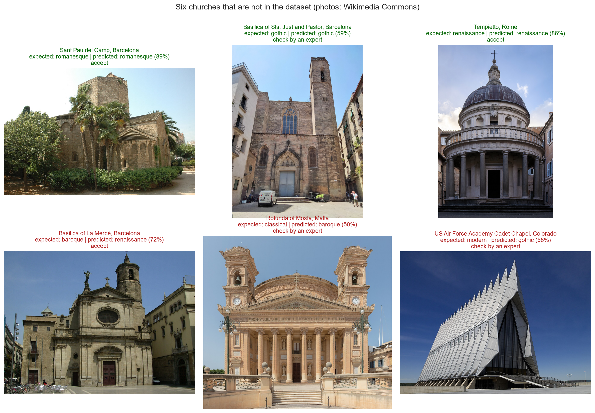

# Church Style Classifier: recognising architectural styles from photos

**Team 5:** Soumyajyoti Datta, Sindhuja Davuluri, Breno Sader, Diego Alpízar
**Course:** AI Methods I – Day 4: Neural networks and computer vision (IAAC MaAI 2026/27)
**Track:** A2 (image classifier, fine-tuned from a pretrained CNN)
**Model on Hugging Face:** https://huggingface.co/iaac-maai/day4-team5-church-style-classifier


*Twelve test images, eight correct and four mistakes (red). The mistakes stay close to the truth: a Renaissance façade predicted Baroque, a Baroque church with a massive medieval-looking tower predicted Romanesque, and medieval churches swapped between Romanesque and Gothic. Low probabilities (31 %, 46 %) show that the model is often unsure even when it is right.*

## Use case

A heritage office or an architecture archive with thousands of untagged photos of churches wants to **pre-sort them by architectural style** (Romanesque, Gothic, Renaissance, Baroque, Classical, Modern), so that experts check the right folders first. A wrong label costs an expert a few seconds to correct; the real risk is a confident mistake that nobody checks, so the model reports its probability and photos below 60 % are flagged for an expert.

## Dataset

| | |
|---|---|
| **Name** | WikiChurches, subset WikiChurches-6 (Barz and Denzler, NeurIPS 2021 Datasets and Benchmarks) |
| **Source** | [Zenodo, DOI 10.5281/zenodo.5166987](https://doi.org/10.5281/zenodo.5166987) · [paper](https://arxiv.org/abs/2108.06959) |
| **Size** | 8,488 photos of church exteriors in 6 styles with official train / validation / test splits made **by church**. We use a reproducible subset of 2,646 images: at most 300 training and 150 test images per style, and the full validation set (306). |
| **Licence** | Dataset: CC BY-SA 4.0. Images: Wikimedia Commons, each with its own free licence (mostly CC BY-SA, CC BY, CC0, public domain); authors and licences are in `image_meta.json`, and the credits of every image shown in our figures are in [`figures/figure_credits.csv`](figures/figure_credits.csv). |

The notebook downloads only the images it needs: it reads the 12.4 GB ZIP on Zenodo **remotely** (byte-range requests) and stores each image resized to 256 px, so less than 100 MB stays on disk.

## Repository structure

```
├── data/                       # downloaded data (not committed): labels, metadata, resized images
├── figures/                    # exported plots (+ figure_credits.csv)
├── models/                     # model card (README.md) + its figures; model.pt lives on Hugging Face
├── notebook/
│   └── neural_network.ipynb    # the full pipeline: data → baseline → training → diagnosis → experiments → test → application
├── .gitignore
├── LICENSE
├── README.md
└── requirements.txt
```

## How to run

```bash
python -m venv .venv
.venv\Scripts\activate           # macOS / Linux: source .venv/bin/activate
pip install torch==2.14.1 torchvision==0.29.1 --index-url https://download.pytorch.org/whl/cu126   # NVIDIA GPU; omit the index URL for CPU
pip install -r requirements.txt
```

Open `notebook/neural_network.ipynb`, select the `.venv` kernel and run all cells. The first run downloads about 3.5 GB once (about 20 minutes: Zenodo allows 133 requests per minute). Training ran on a laptop **NVIDIA RTX 4050** GPU: 5.5 minutes for the main model and 13 minutes for all three experiments; the whole notebook, including the first download, ran in 35 minutes. Without a GPU, the notebook sets `TRAIN = False` and uses the published weights from Hugging Face.

## Approach

- **Architecture:** ResNet18 pretrained on ImageNet (11.2 M parameters), all layers frozen, with a new last layer `nn.Linear(512, 6)` (3,078 trainable parameters).
- **Training:** Adam, learning rate 0.001, batch 32, up to 20 epochs with early stopping on the validation loss (patience 4); augmentation: random resized crops (scale 0.7–1), horizontal flips, brightness and contrast jitter.
- **Baseline:** always predict the majority class of the training set.
- **Experiments (validation set):** (1) a class-weighted loss for the rare styles; (2) fine-tuning the last block (`layer4`) with a 10× smaller learning rate. The final model is selected by validation macro F1.

## Results

Test set: 788 images, used once.

| Model | Accuracy (test) | Balanced accuracy (test) | Macro F1 (test) |
|---|---|---|---|
| Majority baseline | 0.190 | 0.167 | 0.053 |
| **ResNet18, frozen + class weights** | **0.555** | **0.550** | **0.548** |

Validation (306 images) for the three experiments: frozen 0.575 macro F1, **frozen + class weights 0.608** (selected), frozen + class weights + fine-tuned `layer4` 0.570.


*Both frozen models learn quickly and level off after about 10 epochs; the class-weighted model reaches the lowest validation loss (1.05). Fine-tuning `layer4` (epochs 21–26) overfits: the training accuracy jumps to 96 % while the validation loss rises, so we kept the frozen model with class weights.*


*On the 788 test images, the network is about three times better than always predicting the majority class, on every metric (accuracy 0.555 vs 0.190, macro F1 0.548 vs 0.053).*


*Modern churches are recognised in 83 % of cases. The other mistakes stay inside two families: the medieval styles (36 Gothic churches predicted Romanesque, 26 Romanesque predicted Gothic) and the styles that share the classical vocabulary of columns, pediments and domes (Renaissance, Baroque and Classical, confused among themselves). Mistakes across the families are rare.*


*The most confident validation mistakes of the main model: churches that mix building phases (a medieval nave with a later tower), revival or regional features (onion domes read as Baroque), debatable labels (red-brick Neo-Gothic churches labelled Romanesque or Baroque) and unusual close-up views.*


*On six churches that are not in the dataset, the model is right on three. The three mistakes stay inside the expected family; the 60 % threshold sends two of them to an expert, but La Mercè (Baroque, predicted Renaissance at 72 %) passes, so accepted photos should also be sampled.*

## Limitations

- Only church exteriors, mostly from Germany and neighbouring countries: the model knows nothing about other building types and little about churches from other regions.
- Six broad styles: revival styles, regional variants and buildings with several building phases are forced into one class; labels come from Wikidata, not from experts.
- Mostly sunny, frontal, daytime photos from Wikipedia; interiors, details and drone views are rare.
- We used a subset (2,646 of 8,488 images); the test set has about 100–150 images per style, so scores are uncertain by a few points.

## AI usage disclosure

| | |
|---|---|
| **Tools** | Claude Code (Anthropic), used as an agent in VS Code: it read the course notebooks and the brief, ran shell commands and wrote files. |
| **Why** | To check dataset licences, design a download that does not store 12 GB on a laptop, and draft the notebook, README and model card following the brief. |
| **Where** | Dataset search and licence checks; the remote-ZIP download; the notebook code and its explanatory markdown; running the notebook on our laptop GPU; drafts of the readings of the results, this README and the model card. |
| **How** | We asked for a dataset whose licence we could be sure of, then for a notebook following the brief and the class notebooks (e.g. "follow the professor's notebook and the brief, with clear markdown titles and subtitles, everything in English"). The agent ran the notebook, then drafted the readings of every figure and the key findings from the actual outputs. We checked them against the figures and tables, and ... <!-- TO COMPLETE by the team: what you verified, corrected or rewrote, so that you can defend every reading -->. |

**Lessons learned:** ...

## License

Code released under the [MIT License](LICENSE). The model is released under the MIT License (see the model card). The data is subject to its own licence: WikiChurches is CC BY-SA 4.0 and every image keeps its Wikimedia Commons licence.
