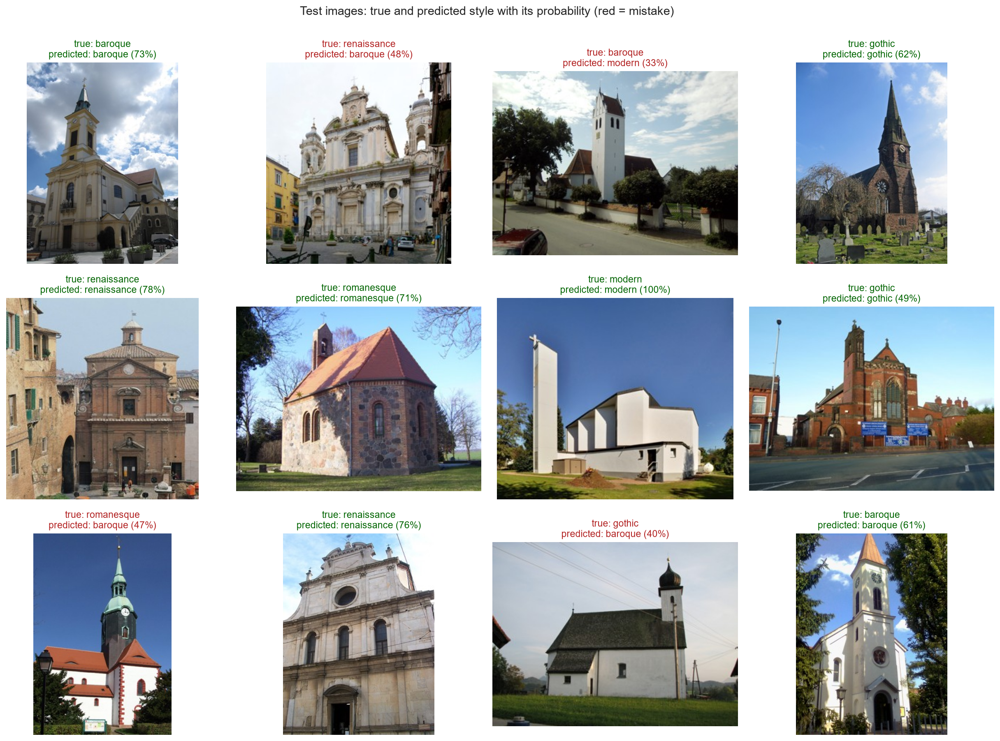
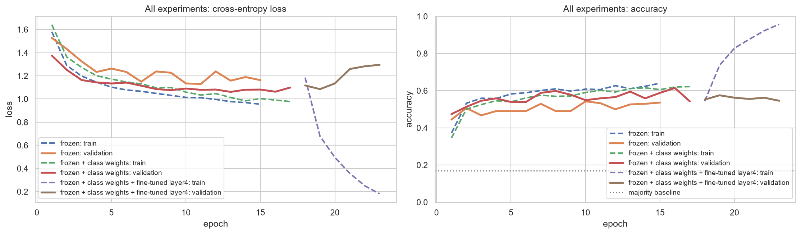
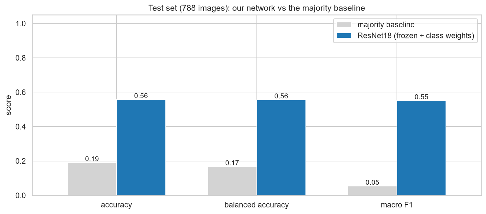
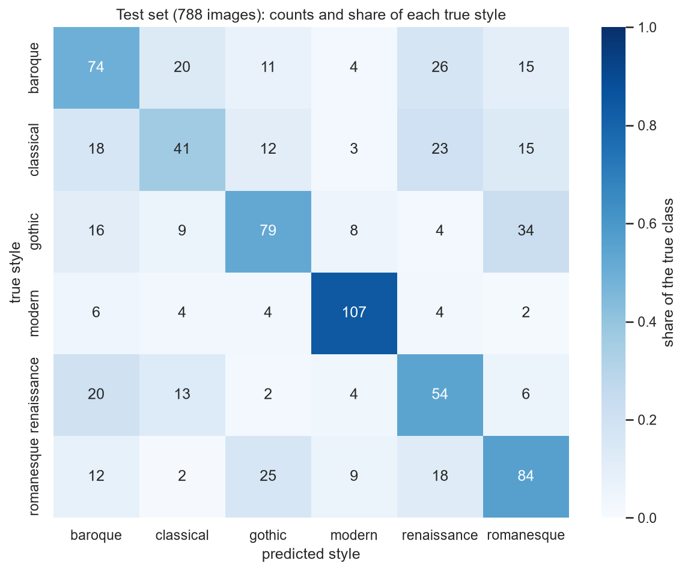
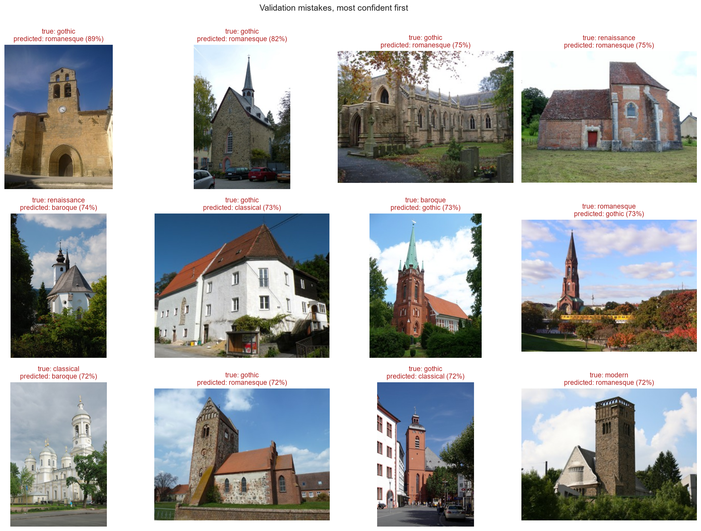
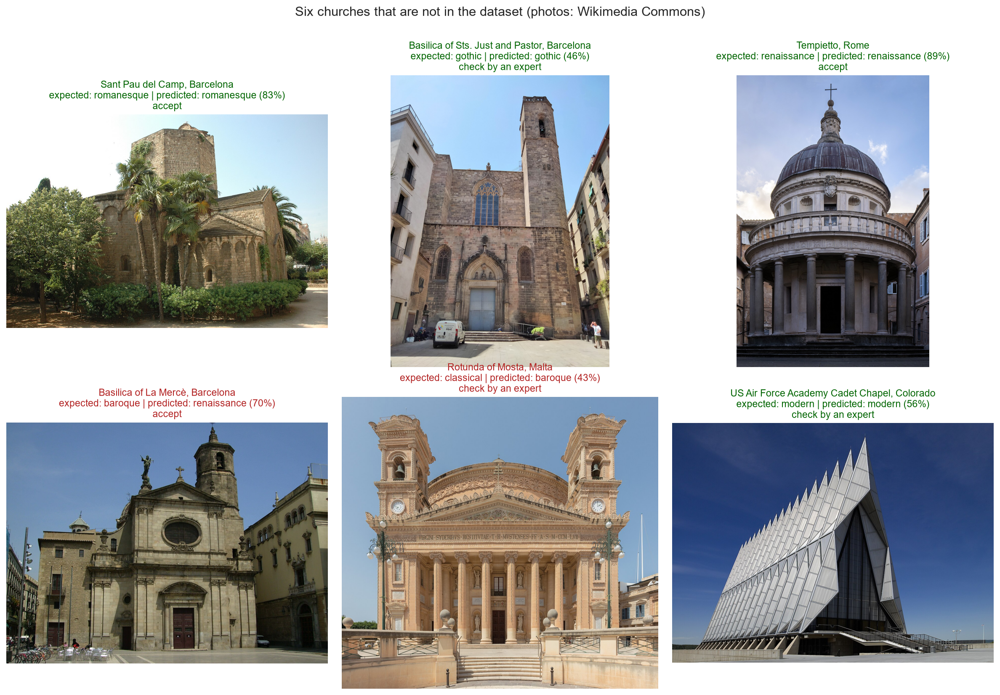

# Church Style Classifier: the architectural style of a church from one photo

This model looks at an **exterior photo of a church** and predicts its **architectural style** among six: Romanesque, Gothic, Renaissance, Baroque, Classical (Neoclassical) and Modern, with a probability for each. It is meant to **pre-sort large photo archives** for heritage experts. It is a **ResNet18** (11.2 M parameters) pretrained on ImageNet, with its layers frozen and a new last layer trained on the **WikiChurches** dataset. It was built as a course assignment for AI Methods I (IAAC MaAI 2026/27).

- **GitHub repository (full pipeline):** https://github.com/iaac-maai/5-day4-assignment
- **Hugging Face repository:** https://huggingface.co/iaac-maai/day4_team5_church_style_classifier
- **Team 5:** Soumyajyoti Datta, Sindhuja Davuluri, Breno Sader, Diego Alpízar

## Model at a glance

The checkpoint was trained again from the notebook because the earlier run's weights were unavailable. The metrics and figures below describe the exported checkpoint from this run.

- **Selected experiment:** frozen + class weights (validation macro F1).
- **Exported at (UTC):** 2026-11-14T11:52:16.758884+00:00.
- **Checkpoint:** `model.pt`, 44.8 MB.
- **SHA-256:** `14478db17436d8a7c56700aebb689931a5f56ecbecf4ccc5a833afad6c8c12a1`.
- **Validation:** strict reload into a fresh CPU model and inference on a real church image passed.

| Metric (788 test images) | Majority baseline | Exported classifier |
| --- | --- | --- |
| accuracy | 0.190 | 0.557 |
| balanced accuracy | 0.167 | 0.556 |
| macro F1 | 0.053 | 0.551 |



The gallery deliberately includes eight correct and four incorrect predictions. Its correct fraction is not an accuracy estimate; use the full test metrics above.

## Intended use

- **Intended users and use:** heritage offices, architecture archives and researchers who want to **pre-sort** many exterior photos of churches by style, with an expert checking the results. Photos with a top probability below **60 %** should always go to an expert. This is a heuristic review threshold; the softmax scores have not been calibrated as correctness probabilities.
- **Out-of-scope uses:** buildings that are not churches; interiors, details, plans or drawings; dating or attributing a specific building; any heritage-protection, legal or funding decision without an expert; churches from regions that are rare in the training data (outside Europe) without checking the results first.

## Model details

| | |
|---|---|
| **Task** | Image classification (one style per image) |
| **Architecture** | ResNet18 with all pretrained layers frozen and a new last layer `nn.Linear(512, 6)` |
| **Parameters** | 11.2 M, of which 3,078 trainable (the last layer) |
| **Base model** | `torchvision` ResNet18, `ResNet18_Weights.DEFAULT`, pretrained on ImageNet-1k |
| **Input** | One RGB image, resized to 256 px, centre-cropped to 224 × 224 and normalised with the ImageNet mean and standard deviation (`ResNet18_Weights.DEFAULT.transforms()`) |
| **Output** | One probability per class (softmax over 6 logits), in the order below |
| **Files** | `model.pt` (weights, `state_dict`), `classes.json` (class order), `training_history.csv`, `experiments.csv`, figures, `figure_credits.csv`, `run_metadata.json`, `test_metrics.csv`, `per_class_test.csv` |
| **Library versions** | torch 2.14.1+cu126, torchvision 0.29.1+cu126, Python 3.14.5; see `requirements.txt` |

### Classes

| ID | Class | Definition (what counts) |
|---|---|---|
| 0 | `baroque` | Baroque churches (17th–18th century, also Rococo): curved façades, rich ornament, domes, dramatic light |
| 1 | `classical` | WikiChurches' *Classical Architecture*: mainly Neoclassical churches, with temple fronts, columns, pediments and domes |
| 2 | `gothic` | Gothic churches (12th–16th century, incl. Brick Gothic and regional variants): pointed arches, buttresses, tall windows and towers |
| 3 | `modern` | WikiChurches' *Modern Architecture*: 20th- and 21st-century churches (incl. Expressionism, Modernism) |
| 4 | `renaissance` | Renaissance churches (15th–17th century): symmetry, classical orders, round arches, domes |
| 5 | `romanesque` | Romanesque churches (10th–12th century): thick walls, round arches, small windows, massive towers |

Labels come from the style of the church in **Wikidata**, regrouped by WikiChurches into these six first-level classes. Revival styles (e.g. Neo-Gothic) are labelled with their historical style.

## Training data

| | |
|---|---|
| **Dataset** | WikiChurches-6 (Barz and Denzler, *WikiChurches: A Fine-Grained Dataset of Architectural Styles with Real-World Challenges*, NeurIPS 2021 Datasets and Benchmarks) |
| **Source** | [Zenodo, DOI 10.5281/zenodo.5166987](https://doi.org/10.5281/zenodo.5166987) |
| **Licence** | Dataset CC BY-SA 4.0; every image keeps its Wikimedia Commons licence (CC BY-SA, CC BY, CC0, public domain…) |
| **Size** | Official splits, made **by church** (no church in two splits). Our reproducible subset (seed 42): **train 1,552** (at most 300 per class; Renaissance has only 64), **validation 306** (about 50 per class), **test 788** (at most 150 per class). |
| **Coverage** | Exterior photos of churches from Wikipedia/Wikidata, mostly in Germany and neighbouring European countries |

### Download the dataset when needed

The dataset is publicly available from the [WikiChurches dataset page on Zenodo](https://zenodo.org/records/5166987), with the permanent identifier [DOI 10.5281/zenodo.5166987](https://doi.org/10.5281/zenodo.5166987). No Hugging Face login is required to download it. The following links were checked on **14 November 2026** using header-only requests; all returned HTTP 200.

| File | Download | Purpose |
|---|---|---|
| `images.zip` | [Download images (12.4 GB)](https://zenodo.org/api/records/5166987/files/images.zip/content) | Full image archive; the notebook downloads only its required subset using HTTP byte ranges |
| `labels.zip` | [Download labels](https://zenodo.org/api/records/5166987/files/labels.zip/content) | Official training, validation and test splits; use the `wc6_*.txt` files for this six-class task |
| `style_names.txt` | [Download style names](https://zenodo.org/api/records/5166987/files/style_names.txt/content) | Mapping from style identifiers to names |
| `image_meta.json` | [Download image metadata](https://zenodo.org/api/records/5166987/files/image_meta.json/content) | Image source, author and licence information |
| `churches.json` | [Download church metadata](https://zenodo.org/api/records/5166987/files/churches.json/content) | Church identifiers and building metadata |

**For training or evaluation:** run `trackB/notebook/neural_network.ipynb` from its notebook directory in the GitHub checkout. It downloads the metadata and the reproducible image subset into `data/`, caches completed downloads, and preserves the official splits by church. The full image archive is not required on disk.

**For prediction:** the dataset is not required. Download `model.pt` and `classes.json` from this model repository and provide your own church photograph, as shown below.

Retain the original image licences and author credits when reusing or sharing photographs.

### Which downloads are actually required?

| What you want to do | Required files | Image download required? |
|---|---|---|
| Classify your own photograph | `model.pt` (44.8 MB), `classes.json`, and the prediction code below | **No training images** |
| Repeat the notebook's experiments and reported evaluation | Metadata and the notebook's 2,646-image subset: 1,552 train, 306 validation, 788 test | **Yes**: approximately 3.5 GB transferred once, leaving 75 MB of resized images plus metadata |
| Work with every original dataset image | Full `images.zip` and metadata | Optional 12.4 GB image archive; not needed for this notebook's subset |

Downloading software dependencies is separate from these sizes. Installing PyTorch can itself be a substantial download; reuse a compatible existing environment where available.

### Retrain or reproduce the evaluation

1. Download the [executed notebook](https://huggingface.co/iaac-maai/day4_team5_church_style_classifier/resolve/main/neural_network.ipynb) and [requirements.txt](requirements.txt). In a new project folder, put the notebook in a `notebook/` subfolder and the requirements file at the project root. The notebook creates sibling `data/`, `models/`, and `figures/` folders.
2. Create a Python environment and install the requirements. The exported run used Python 3.14.5. For an NVIDIA GPU, install the CUDA builds of torch and torchvision first, using the command in `requirements.txt`; then install the remaining packages with `python -m pip install -r requirements.txt`.
3. Open the notebook with that environment as its kernel and its working directory set to `notebook/`.
4. Set `TRAIN = True`. Set `RETRAIN = True` if a checkpoint already exists and you want to repeat all three experiments. Keep `TRAIN_CAP = 300`, `TEST_CAP = 150`, and seed 42 to use the reported subset. Leave the validation set intact.
5. Run all cells. The notebook downloads labels, metadata and only the selected images from the remote archive, keeping train/validation/test churches separate. It selects an experiment on validation macro F1, saves `models/model.pt`, and evaluates on the held-out test set.

The first image download takes around 20 minutes under Zenodo's request limit. Do not increase request concurrency to bypass that limit. Existing images and metadata are cached in `data/`; resuming the notebook downloads only missing images, although it still contacts Zenodo to read the archive index. GPU training in the exported run took about two minutes across the three experiments; other machines can take longer.

**Important:** setting `TRAIN = False` skips training, but running the whole notebook still prepares the dataset for its figures and evaluation. Use the standalone prediction workflow below to avoid downloading training images entirely.

### Alternatives to the large dataset transfer

- **Recommended for using the classifier:** use the existing trained checkpoint with `predict.py` below. This downloads the 44.8 MB model once and never requests the training dataset. A CPU is sufficient.
- **For repeated experiments on this computer:** reuse the existing `data/` cache. The resized subset is already downloaded, so you do not need to repeat the approximately 3.5 GB transfer. Preserve its folder structure and licence metadata.
- **For a quick training smoke test:** lower `TRAIN_CAP` and `TEST_CAP` before the first download in a separate project folder, for example to 20 and 10. With the full 306-image validation set, that requests 486 images instead of 2,646. This changes the experiment and cannot reproduce the published scores. Changing caps does not remove existing images from cached class folders, so use a fresh `data/` directory for the smaller experiment.

The public repository does not currently host a packaged copy of the resized training subset. Its full-experiment download remains the Zenodo workflow above.

## Training procedure

- Adam, learning rate 0.001 for the output layer, batch size 32, up to 20 epochs, with early stopping on validation loss (patience 4).
- Augmentation: random resized crops (scale 0.7–1), horizontal flips, brightness and contrast jitter. Frozen BatchNorm layers retain ImageNet statistics.
- Experiments: frozen backbone; inverse-frequency class-weighted cross entropy; and fine-tuning `layer4` from the better frozen model at learning rate 0.0001 for up to 10 more epochs.
- Model selection: choose the experiment by validation macro F1, using its checkpoint with lowest validation loss. The held-out test set is evaluated after selection.
- This run: NVIDIA GeForce RTX 4070 Laptop GPU; selected experiment trained for 17 epochs in 0.9 minutes. Environment and checksum are in `run_metadata.json`.

| Experiment | Validation accuracy | Validation macro F1 |
| --- | --- | --- |
| frozen | 0.533 | 0.517 |
| frozen + class weights | 0.595 | 0.586 |
| frozen + class weights + fine-tuned layer4 | 0.575 | 0.577 |



## Evaluation

| Metric (788 test images) | Majority baseline | Exported classifier |
| --- | --- | --- |
| accuracy | 0.190 | 0.557 |
| balanced accuracy | 0.167 | 0.556 |
| macro F1 | 0.053 | 0.551 |

| Class | Precision | Recall | F1 |
| --- | --- | --- | --- |
| baroque | 0.507 | 0.493 | 0.500 |
| classical | 0.461 | 0.366 | 0.408 |
| gothic | 0.594 | 0.527 | 0.558 |
| modern | 0.793 | 0.843 | 0.817 |
| renaissance | 0.419 | 0.545 | 0.474 |
| romanesque | 0.538 | 0.560 | 0.549 |







The confusion matrix and per-class metrics show where the styles are confused. Mixed construction phases, revival styles and close-up views can make a single style label ambiguous. The validation mistake gallery diagnoses the initial frozen model; test results evaluate the selected model.

### Additional churches

The model classified 4 of 6 additional churches correctly. The heuristic 60% threshold flagged 3 photographs. These six images are an application demonstration, not a separate benchmark. Full predictions are in `new_church_predictions.csv`.



## Limitations and biases

- **Only church exteriors, mostly European.** The model has never seen other building types and few churches outside Europe.
- **Six broad classes.** Revival styles, regional variants and churches with several building phases are forced into one class; the labels come from Wikidata and were not checked by experts.
- **Photo conditions.** Training photos are mostly sunny, frontal, daytime views of whole buildings from Wikipedia; interiors, details, night, snow or drone views may fail.
- **Small and imbalanced rare classes.** Renaissance has only 64 training images; per-class scores are uncertain by several points.

## Ethics and privacy

The images show buildings; some contain passers-by, but they are small and incidental, and all images were already published on Wikimedia Commons under free licences. The model makes no prediction about people.

## How to use

The trained `model.pt` checkpoint and `classes.json` are available in this repository. The checkpoint contains the complete ResNet18 state dictionary, so no ImageNet download is needed for prediction.

### Option 1: run a standalone prediction without training images

In an existing compatible Python environment, skip installation. Otherwise create a virtual environment (the exported run used Python 3.14.5) and activate it:

```bash
python -m venv .venv
```

On Windows PowerShell, activate with `.\.venv\Scripts\Activate.ps1`; on macOS/Linux, use `source .venv/bin/activate`. Install only the inference packages; CPU builds avoid installing the CUDA runtime:

```bash
python -m pip install torch==2.14.1 torchvision==0.29.1 --index-url https://download.pytorch.org/whl/cpu
python -m pip install pillow==13.0.0 huggingface_hub==2.4.0
```

Download the small [prediction script](predict.py) and classify your own photo:

```bash
python -c "from huggingface_hub import hf_hub_download; hf_hub_download('iaac-maai/day4_team5_church_style_classifier', 'predict.py', local_dir='church_classifier')"
python church_classifier/predict.py "path/to/church.jpg"
```

Replace `path/to/church.jpg` with your image path. The first prediction downloads `model.pt` and `classes.json` to the Hugging Face cache. Later predictions reuse those files. The script prints the predicted style, all six softmax scores, and a `review_by_expert` flag when the highest score is below 0.6. The scores are not calibrated correctness probabilities.

For a fully offline run, download [model.pt](model.pt), [classes.json](classes.json), and [predict.py](predict.py) ahead of time into the same local folder, install the dependencies, then run:

```bash
python church_classifier/predict.py "path/to/church.jpg" --model-dir church_classifier
```

With `--model-dir`, the script makes no Hugging Face requests. Internet access and a GPU are not required at prediction time. The repository provides downloadable torchvision weights; it does not itself provide a hosted prediction endpoint.

### Option 2: use the model in your own Python code

```python
import json
import torch
from torch import nn
from torchvision import models
from PIL import Image, ImageOps
from huggingface_hub import hf_hub_download

REPO = "iaac-maai/day4_team5_church_style_classifier"
with open(hf_hub_download(REPO, "classes.json"), encoding="utf-8") as f:
    CLASSES = json.load(f)

model = models.resnet18(weights=None)                                     # the same architecture...
model.fc = nn.Linear(model.fc.in_features, len(CLASSES))      # ...with the same last layer
model.load_state_dict(torch.load(hf_hub_download(REPO, "model.pt"), map_location="cpu", weights_only=True))
model.eval()

transform = models.ResNet18_Weights.DEFAULT.transforms()      # the same preprocessing as in training
image = ImageOps.exif_transpose(Image.open("church.jpg")).convert("RGB")
with torch.no_grad():
    probabilities = torch.softmax(model(transform(image).unsqueeze(0)), dim=1)[0]
print(dict(zip(CLASSES, [round(p, 3) for p in probabilities.tolist()])))
```

⚠️ `.pt` files are Python pickles and can execute code when loaded: only load models from sources you trust. Use the library versions listed above.

## Reproducibility

The full pipeline is in the GitHub repository: https://github.com/iaac-maai/5-day4-assignment. In the GitHub checkout, run `trackB/notebook/neural_network.ipynb` with the packages in `trackB/requirements.txt` (seed 42 everywhere). The [notebook hosted here](https://huggingface.co/iaac-maai/day4_team5_church_style_classifier/resolve/main/neural_network.ipynb) also works in a standalone project: place it in a `notebook/` folder as described above.

## Authors and licence

Soumyajyoti Datta, Sindhuja Davuluri, Breno Sader, Diego Alpízar. Course assignment for **AI Methods I: Machine Learning for the Built Environment**, IAAC MaAI 2026/27.

Model released under the MIT License. The data is subject to its own licence: WikiChurches is CC BY-SA 4.0 (Barz and Denzler, 2021), and every image keeps its Wikimedia Commons licence; the authors and licences of the images shown in this card are listed in `figure_credits.csv`.

The checkpoint uses torchvision, rather than Transformers AutoModel. Reconstruct the architecture with the example above. GPU and library differences can change exact results despite seed 42.

## GitHub folder layout

The GitHub repository separates `trackA/` (Melbourne house prices) and `trackB/` (this classifier). This model card is at `trackB/models/README.md`; the notebook is at `trackB/notebook/neural_network.ipynb`. Data, figures, weights, and dependencies belong to `trackB/`. Hugging Face keeps the model files at the repository root, so its download and prediction commands above remain valid.
